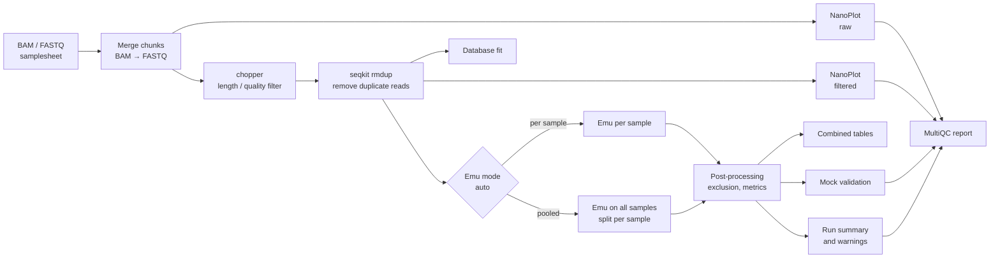

<h1>
  <picture>
    <source media="(prefers-color-scheme: dark)" srcset="docs/images/ont16s_logo_dark.svg">
    
  </picture>
</h1>

[](https://doi.org/10.5281/zenodo.24053595)
[](https://github.com/YiannisGal/ont16s/actions/workflows/nf-test.yml)
[](https://github.com/YiannisGal/ont16s/actions/workflows/linting.yml)
[](https://www.nextflow.io/)
[](https://www.docker.com/)
[](https://github.com/nf-core/tools/releases/tag/4.2.1)

## Introduction

**ont16s** is a Nextflow pipeline for **full-length 16S rRNA gene amplicons sequenced on Oxford
Nanopore** (e.g. SQK-16S114, SQK-MAB114). It turns raw reads (BAM or FASTQ) into taxonomic
abundance tables with [Emu](https://github.com/treangenlab/emu), and checks the data and the result
along the way:

- **any samples**: environmental, host-associated or mock communities, from one to hundreds;
- **any Emu database**, with its provenance recorded (Emu's default database, SILVA 138.2 grouped by
  genus, or your own);
- **automatic pooling** of shallow samples, so that rare taxa are not lost to Emu's per-run abundance
  floor;
- **quality checks with reasons**: duplicated reads, reads lost in filtering, low depth, unassigned
  reads, organelles, database fit;
- **mock-community validation** against expected composition (presence/absence and proportions).

It is built on the [nf-core](https://nf-co.re) template (tested modules, pinned containers, CI).

## Pipeline overview



1. **Read preparation**: merge chunks of the same sample, convert unaligned BAM to FASTQ
   ([samtools](https://www.htslib.org/)), concatenate/compress FASTQ.
2. **Read QC** before and after filtering ([NanoPlot](https://github.com/wdecoster/NanoPlot)).
3. **Length/quality filter** ([chopper](https://github.com/wdecoster/chopper); default 1,000–2,000 bp).
4. **Duplicate-read removal** ([seqkit](https://bioinf.shenwei.me/seqkit/)): identical reads written
   twice (e.g. overlapping chunks) are removed and reported.
5. **Taxonomic profiling** with [Emu](https://github.com/treangenlab/emu), per sample or pooled across
   samples (`--emu_mode auto` decides).
6. **Post-processing**: optional taxon exclusion (e.g. chloroplasts), per-sample read accounting.
7. **Outputs**: per-sample and combined tables (species and genus, abundance and counts), database
   provenance, mock validation, run summary and warnings, [MultiQC](https://multiqc.info/) report.

## Quick start

Requirements: [Nextflow](https://www.nextflow.io/docs/latest/install.html) ≥ 25.10.4 (Java 17+) and
[Docker](https://docs.docker.com/engine/install/).

```bash
# 1. Run the built-in test (downloads a 0.7 MB test BAM and a 1.5 MB test database)
nextflow run YiannisGal/ont16s -r v0.1.0 -profile test,docker --outdir results_test
```

The test takes about 2–3 minutes on 2 CPUs and should report the 12 expected bacteria of a Zymo mock
community (`results_test/mock_validation/mock_validation_summary.tsv`).

```bash
# 2. Run your data
nextflow run YiannisGal/ont16s -r v0.1.0 \
    -profile docker \
    --input samplesheet.csv \
    --emu_db /path/to/emu_db \
    --outdir results
```

## Installation

1. **Nextflow** (≥ 25.10.4, needs Java 17 or newer):

   ```bash
   curl -s https://get.nextflow.io | bash
   mv nextflow ~/bin/      # or any directory on your PATH
   nextflow -version
   ```

2. **A software environment.** `-profile docker`, `-profile singularity` and `-profile conda` are
   tested in CI on every change. `apptainer` and `podman` profiles are provided but not tested.

3. **The pipeline.** Nextflow downloads it from GitHub on first use; nothing to install by hand.
   To work on the code instead, clone it:

   ```bash
   git clone https://github.com/YiannisGal/ont16s.git
   ```

4. **An Emu database** (see [Databases](#databases)).

Use `-r <version>` (e.g. `-r v0.1.0`) to run a fixed release.

## Test data

`-profile test` uses public data from
[YiannisGal/ont16s-test-datasets](https://github.com/YiannisGal/ont16s-test-datasets):

| File                                                  | Content                                                                                               |
| ----------------------------------------------------- | ----------------------------------------------------------------------------------------------------- |
| `zymo_msplus/zymo_msplus_mab114_sup_rep1_sub1pct.bam` | 546 reads (1 % subset) of an ONT Zymo mock (R10.4.1, SUP, SQK-MAB114-24), ONT Open Data, CC BY-NC 4.0 |
| `emu_db_zymo_genera.tar.gz`                           | Emu default database reduced to the 15 genera of the mock (955 species)                               |

How they were made (commands, checksums, licences) is documented in that repository.

## Samplesheet

One row per reads file; files with the same `sample` are merged.

```csv
sample,reads,mock
soil_rep1,/data/soil_rep1.fastq.gz,
zymo_ctrl,/data/run1/FBB32095_pass_0.bam,zymo_msplus
zymo_ctrl,/data/run1/FBB32095_pass_1.bam,zymo_msplus
```

| Column   | Required | Description                                                                                                  |
| -------- | -------- | ------------------------------------------------------------------------------------------------------------ |
| `sample` | yes      | sample name, no spaces                                                                                       |
| `reads`  | yes      | unaligned BAM, `.fastq`, `.fq`, `.fastq.gz` or `.fq.gz` (path or URL)                                        |
| `mock`   | no       | name of a mock community definition (e.g. `zymo_msplus`, `zymo_d6306`, `zymo_d6331`); empty for real samples |

## Databases

`--emu_db` takes a directory with `species_taxid.fasta` and `taxonomy.tsv`, or a `.tar`/`.tar.gz`
archive of it (local path or URL).

| Database                                         | Best for                                                                 | How to get it                                                                                                                                      |
| ------------------------------------------------ | ------------------------------------------------------------------------ | -------------------------------------------------------------------------------------------------------------------------------------------------- |
| Emu default (rrnDB v5.6 + NCBI 16S RefSeq, 2020) | species-level names in well-studied communities (mocks, host-associated) | `osf -p 56uf7 fetch osfstorage/emu-prebuilt/emu.tar`                                                                                               |
| **SILVA 138.2 grouped by genus**                 | environmental samples with many uncultured lineages; labels organelles   | build from Emu's SILVA download with [`bin/build_silva_genus_db.py`](bin/build_silva_genus_db.py) (see [usage](docs/usage.md#choosing-a-database)) |
| your own                                         | anything else                                                            | any Emu-format database                                                                                                                            |

The checksums and size of the database used are written to
`pipeline_info/emu_db_provenance.tsv` in every run.

## Main parameters

| Parameter                                 | Default        | Description                                                                                    |
| ----------------------------------------- | -------------- | ---------------------------------------------------------------------------------------------- |
| `--input`                                 | —              | samplesheet (CSV)                                                                              |
| `--outdir`                                | —              | output directory                                                                               |
| `--emu_db`                                | —              | Emu database (directory or archive)                                                            |
| `--emu_mode`                              | `auto`         | `per_sample`, `pooled`, or `auto` (pooled when ≥ 25 % of samples have < 10,000 filtered reads) |
| `--min_read_length` / `--max_read_length` | 1000 / 2000    | read length window (bp)                                                                        |
| `--min_read_qual`                         | 0 (off)        | minimum mean read quality                                                                      |
| `--emu_type`                              | `map-ont`      | minimap2 preset used by Emu                                                                    |
| `--exclude_taxa`                          | —              | comma-separated lineage terms to remove, e.g. `chloroplast,mitochondria`                       |
| `--mock_definitions`                      | `assets/mocks` | directory of mock definitions                                                                  |

All parameters, thresholds and their justification: [docs/usage.md](docs/usage.md), or
`nextflow run YiannisGal/ont16s --help`.

## Outputs

| Directory          | Content                                                                                                       |
| ------------------ | ------------------------------------------------------------------------------------------------------------- |
| `emu/`             | per-sample Emu tables; `emu-combined-{species,genus}[-counts].tsv` (taxa × samples); `pooled/` in pooled mode |
| `ont16s_report/`   | `ont16s_run_summary.tsv` (one row per sample) and `ont16s_warnings.tsv` (every warning with its reason)       |
| `mock_validation/` | per-mock-sample expected vs observed taxa and a summary (recall, false positives, L1 distance)                |
| `qc/`              | NanoPlot reports (raw/filtered), Emu read accounting, database fit                                            |
| `multiqc/`         | MultiQC report combining QC, warnings and validation                                                          |
| `pipeline_info/`   | software versions, database provenance, Nextflow reports                                                      |

Details: [docs/output.md](docs/output.md).

## Validation

Measured with this pipeline (details and data in [docs/server-tasks](docs/server-tasks/)):

| Dataset                                                               | Result                                                                                                                                                                                                                          |
| --------------------------------------------------------------------- | ------------------------------------------------------------------------------------------------------------------------------------------------------------------------------------------------------------------------------- |
| Zymo MSPlus mock, ONT R10.4.1 SUP (ST-001, ST-008)                    | all 12 expected bacteria detected; 0.6 % of abundance assigned to unexpected taxa                                                                                                                                               |
| Environmental samples, PRJNA925180 (soil, lake, freshwater; ST-004)   | replicates agree (Bray-Curtis ≤ 0.27), habitats separate (0.62–0.92)                                                                                                                                                            |
| Lake-sediment core, 70 samples, R10.4.1 fast basecalling (ST-005–009) | vs a published NanoCLUST + SILVA analysis of the same reads: same between-sample pattern (Mantel r = 0.96 phylum, 0.95 genus), all published phyla detected, 36 min on 24 CPUs; [comparison](docs/etoliko-method-comparison.md) |

Not yet done: an independent-laboratory mock (NaMeco, PRJEB82315), tests on HPC/cloud, and
proportion accuracy against Zymo's expected 16S composition.

## Limitations

- Taxonomy depends on the database; Emu assigns every read to its closest reference, so organisms
  absent from the database appear under a related name.
- No representative sequences are produced (yet).
- Tested on Linux x86_64 (Docker, Singularity, conda); ARM64, HPC schedulers and cloud are not yet tested.

## Credits

ont16s was written by IGaliatsatos ([@YiannisGal](https://github.com/YiannisGal)).

## Citations

If you use ont16s, please cite the pipeline:

> Galiatsatos I. ont16s: full-length 16S rRNA profiling for Oxford Nanopore (v0.1.0). Zenodo.
> doi: [10.5281/zenodo.24053595](https://doi.org/10.5281/zenodo.24053595)

Please also cite the tools it runs, listed with references in
[CITATIONS.md](CITATIONS.md), in particular:

> Curry KD, Wang Q, Nute MG, et al. Emu: species-level microbial community profiling of full-length
> 16S rRNA Oxford Nanopore sequencing data. _Nat Methods_ 19, 845–853 (2022).
> doi: [10.1038/s41592-022-01520-4](https://doi.org/10.1038/s41592-022-01520-4)

and the database you used. This pipeline uses code and infrastructure developed and maintained by the
[nf-core](https://nf-co.re) community, reused here under the
[MIT license](https://github.com/nf-core/tools/blob/main/LICENSE).

> Ewels PA, Peltzer A, Fillinger S, et al. The nf-core framework for community-curated bioinformatics
> pipelines. _Nat Biotechnol._ 2020;38(3):276-278. doi: [10.1038/s41587-020-0439-x](https://dx.doi.org/10.1038/s41587-020-0439-x)
